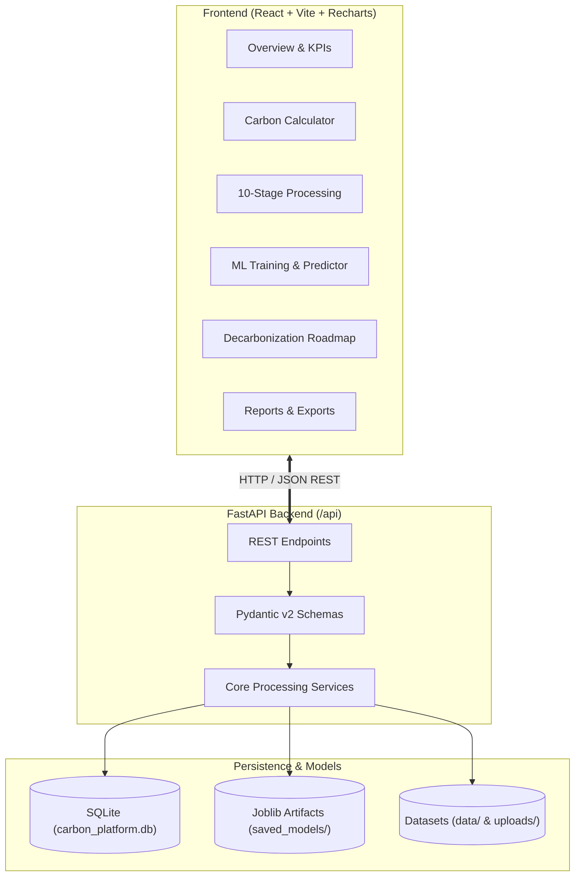

# Carbon Footprinting & Sustainability Platform

[](file:///backend/tests)
[](https://fastapi.tiangolo.com)
[](https://react.dev)
[](https://scikit-learn.org)
[](https://tailwindcss.com)
[](file:///docs/architecture.md)

An end-to-end full-stack web application designed to help individuals and organizations quantify, analyze, predict, and reduce greenhouse gas (GHG) emissions across electricity, transportation, stationary fuels, and facility operations.

Built for **Project-Based Learning (PBL)** presentation and viva demonstration with transparent calculations, Scikit-learn Machine Learning pipelines, interactive Power BI-style dashboards, and an actionable decarbonization recommendation engine.

---

## 1. Project Overview & Motivation

Climate governance requires transitioning from retroactive carbon accounting to forward-looking predictive modeling. **CarbonSphere** integrates:
1. **GHG Protocol Standards**: Computes Scope 1, Scope 2, and Scope 3 emissions using verified regional emission factors from **India CEA Baseline Ver 19**, **US EPA eGRID 2022**, and **UK DEFRA 2023**.
2. **10-Stage Data Processing Engine**: Handles CSV ingestion, column schema mapping, missing value imputation, and Interquartile Range (IQR) outlier detection.
3. **Machine Learning Pipeline**: Trains and compares **Random Forest**, **Gradient Boosting**, and **Linear Regression** models on held-out test data, reporting real MAE, RMSE, and $R^2$ scores, alongside **K-Means Clustering** for activity archetype segmentation.
4. **Power BI-Inspired Reporting Interface**: Provides interactive KPI cards, category contribution donuts, monthly timeline trajectories, facility benchmarks, and binned intensity histograms.
5. **Decarbonization Engine & What-If Simulator**: Generates data-driven efficiency recommendations and scenario projections without fabricating guarantees.

---

## 2. Technology Stack

### Frontend
- **Framework**: React 19 with TypeScript, powered by Vite
- **Styling**: Tailwind CSS (custom Forest Green, Emerald, and Sage ESG palette)
- **Charts**: Recharts (Bar, Donut, Area, Scatter, and Histograms)
- **Icons**: Lucide React
- **Routing**: React Router DOM (v7)

### Backend
- **Framework**: FastAPI (Python 3.10 / 3.14)
- **Server**: Uvicorn ASGI server
- **Validation**: Pydantic v2 schemas
- **Database**: SQLite with SQLAlchemy ORM
- **Data Science**: Pandas, NumPy, Scikit-learn, SciPy, Joblib
- **Testing**: Pytest & Starlette TestClient

---

## 3. Architecture & Data Workflow



Detailed technical specifications are documented in:
- [System Architecture](file:///docs/architecture.md)
- [Data & Operational Workflow](file:///docs/workflow.md)

---

## 4. Platform Modules & Features

| Page / Module | URL Route | Key Functionalities |
| :--- | :--- | :--- |
| **1. Landing Page** | `/` | Hero section, environmental statistics cards, methodology guide, feature cards, and climate compliance rationale. |
| **2. Main Dashboard** | `/dashboard` | Power BI-style reporting, 6 KPI cards with tooltips, Category Bar, Donut Share, Monthly Area trajectory, Facility Benchmark, and Filter Bar (Category, Facility, Period, Dataset). |
| **3. Carbon Calculator** | `/calculator` | Categorized forms (Electricity, Transport, Fuel, Facilities), regional grid factor picker (India CEA, US EPA, UK DEFRA), custom factor overrides, mathematical breakdown, persistent SQLite history, and CSV export. |
| **4. Emission Analytics** | `/analytics` | 10-stage Pandas pipeline, auto-suggested column mapping engine, IQR outlier detection, data quality scoring (0-100), and Pearson correlation matrix. |
| **5. Dataset Management** | `/datasets` | Secure CSV upload (<10 MB, UUID sanitization), 10-row schema preview, null/duplicate audits, template download, and clean CSV export. |
| **6. ML Predictions** | `/predictions` | Supervised regression (Random Forest, Gradient Boosting, Linear Regression), real MAE, RMSE, $R^2$ metrics, actual vs. predicted chart, residual chart, live predictor form, and unsupervised K-Means clustering explorer. |
| **7. Recommendations** | `/recommendations` | Transparent rule-based efficiency suggestions, interactive What-If scenario slider with projected savings calculation, and persistent user action plans. |
| **8. Reports & Exports** | `/reports` | Executive sustainability disclosure report, category breakdown table, ML model evaluation scorecard, browser print-to-PDF styles, and raw CSV export. |
| **9. About Project** | `/about` | PBL viva presentation guide, motivation, objectives, 8-stage workflow diagram, architecture explanation, and implemented vs. future work matrix. |

---

## 5. Local Setup & Installation (Windows Environment)

### Prerequisites
- **Python**: 3.10, 3.11, 3.12, or 3.14 installed with `pip`
- **Node.js**: v18+ (tested on Node v24 & npm 11)
- **Git** (optional)

### Step 1: Clone or Navigate to the Workspace
Open PowerShell in the project directory:
```powershell
cd c:\Users\user\OneDrive\Desktop\carbonfootprinting
```

### Step 2: Backend Setup
Create and activate a Python virtual environment (optional but recommended):
```powershell
python -m venv venv
.\venv\Scripts\Activate.ps1
```

Install backend dependencies:
```powershell
python -m pip install -r backend/requirements.txt
```

Verify backend installation by running the test suite:
```powershell
python -m pytest backend/tests -v
```
*(All 15 tests should pass with 100% success rate)*.

### Step 3: Frontend Setup
In the same or a separate PowerShell terminal:
```powershell
cd frontend
npm install
```

---

## 6. Running the Application

To run the complete platform locally, open two terminal windows:

### Terminal 1: Start the FastAPI Backend
```powershell
cd c:\Users\user\OneDrive\Desktop\carbonfootprinting
python -m uvicorn backend.app.main:app --reload --host 127.0.0.1 --port 8000
```
- Backend REST API will be live at: **`http://127.0.0.1:8000`**
- Interactive Swagger OpenAPI Documentation: **`http://127.0.0.1:8000/docs`**
- ReDoc API Documentation: **`http://127.0.0.1:8000/redoc`**
- Health Check: **`http://127.0.0.1:8000/api/health`**

### Terminal 2: Start the React + Vite Frontend
```powershell
cd c:\Users\user\OneDrive\Desktop\carbonfootprinting\frontend
npm run dev
```
- Frontend application will be live at: **`http://localhost:5173`**
- Open your browser and navigate to `http://localhost:5173` to explore all 9 working modules!

---

## 7. Pre-loaded Verified Datasets

The repository includes pre-populated, verified demo datasets in `data/demo_datasets/`:
1. `enterprise_esg_operations.csv`: 180 multi-department monthly records across Headquarters, Manufacturing Plant A, Data Center, Logistics Hub, and Regional Office.
2. `fleet_transport_emissions.csv`: 180 logistics telematics records with `Trip_Distance_km`, `Cargo_Weight_Tonnes`, `Avg_Speed_kmh`, `Ambient_Temp_C`, `Fuel_Energy_Consumed`, and target `Emissions_kgCO2e`.
3. `data/sample_templates/carbon_activity_template.csv`: Standardized blank template for organizations to upload their own activity records.

---

## 8. Academic PBL Viva & Presentation Guide

When presenting this project for your Project-Based Learning (PBL) Viva examination, highlight these key engineering strengths:
1. **No Hardcoded Output**: All dashboard figures, ML metrics, and calculations are computed dynamically in real time from Pandas and Scikit-learn.
2. **Transparent Formulas**: Explain that emissions follow the GHG Protocol equation:
   $$\text{Emissions } (\text{kg CO}_2\text{e}) = \text{Activity Amount} \times \text{Emission Factor}$$
3. **No Target Leakage**: Show how the Scikit-learn preprocessing pipeline separates train and test sets prior to imputation and scaling.
4. **Outlier Detection**: Demonstrate the IQR statistical audit in the Analytics page identifying abnormal spikes in energy bills.
5. **Demonstrable Codebase**: Point to the 15 passing automated unit and integration tests verifying formula validity and API contracts.

---

## 9. License & Disclaimers

- Built for academic and research evaluation.
- All emission factors are sourced from public official regulatory bodies (India Central Electricity Authority, US EPA eGRID, UK DEFRA / DESNZ).
- What-If simulations are clearly labeled as estimations.
