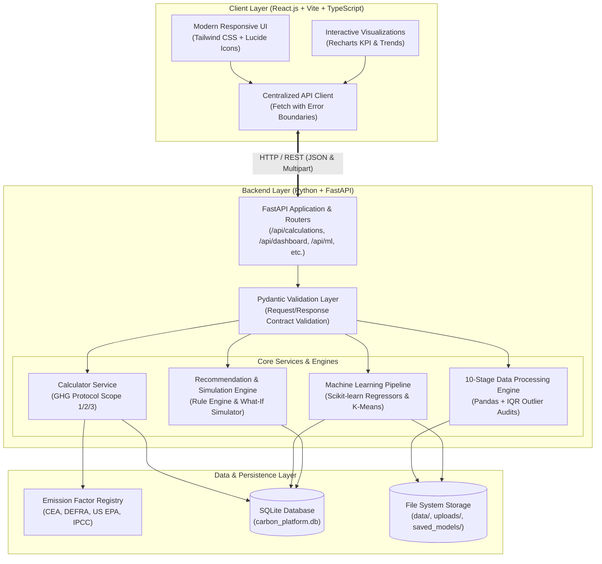

# System Architecture: Carbon Footprinting & Sustainability Platform

This document describes the end-to-end technical architecture, layer interactions, and data storage design of the **Carbon Footprinting & Sustainability Platform** (Academic BTech PBL Capstone Project).

---

## 1. High-Level Architecture Diagram

---

## 2. Layered Responsibilities

### 2.1 Presentation Layer (Frontend)
- **Framework**: React 19 with TypeScript, bundled by Vite.
- **Styling**: Tailwind CSS configured with a dedicated palette:
  - *Forest Green* (`#15803d` / `#14532d`): Primary sustainability brand actions and confirmed states.
  - *Emerald Green* (`#059669`): Low-intensity indicators, savings metrics, and positive trends.
  - *Soft Sage* (`#e3e8e4` / `#f6f7f6`): Subtle card borders and neutral backgrounds.
  - *White / Slate*: Clean typography, high contrast, and accessible UI layout.
- **Visualizations**: Built with **Recharts**:
  - Horizontal & vertical Bar charts for category and facility comparisons.
  - Donut pie charts with custom legends for proportional sector contribution.
  - Area charts for monthly chronological emission trajectories.
  - 2D Scatter charts for actual vs. predicted regression test points and K-Means cluster PCA projections.
  - Intensity distribution histograms across binned emissions.

### 2.2 Application & Service Layer (Backend)
- **Framework**: **FastAPI** running on Uvicorn.
- **Validation**: **Pydantic v2** models enforce strict data types, positive numerical bounds, and formatted error messages.
- **CORS**: Configured with origins supporting local Vite ports (`5173`, `3000`, `8000`).
- **Separation of Concerns**: Route handlers delegate all computation to dedicated services (`CalculatorService`, `DataProcessor`, `MLPipelineService`, `RecommendationService`).

### 2.3 Data Science & Machine Learning Pipeline
- **Libraries**: Pandas, NumPy, Scikit-learn, Joblib.
- **Pipelines**:
  - `ColumnTransformer` applies `StandardScaler` to continuous features and `OneHotEncoder(handle_unknown='ignore')` to categorical fields.
  - `SimpleImputer` replaces missing numeric values with medians to prevent training leakage.
  - Models evaluated on held-out test splits (80% train / 20% test) using **Random Forest**, **Gradient Boosting**, and **Linear Regression**.
  - Trained pipelines serialized via `joblib` into `saved_models/` for low-latency inference on single user inputs.
  - `KMeans` clustering discovers operational intensity archetypes, visualized in 2D via PCA dimensionality reduction.

---

## 3. Database Schema Design (SQLite)

```mermaid
erDiagram
    DATASETS {
        string id PK "UUID"
        string filename "Sanitized system name"
        string original_name "User uploaded name"
        string file_path "Local disk path"
        int row_count "Total records"
        text columns_json "Indexed header array"
        string status "ready | processing"
        boolean is_demo "Demo dataset indicator"
        datetime uploaded_at "UTC Timestamp"
    }

    CALCULATIONS {
        string id PK "UUID"
        string category "Electricity | Transport | Fuel | Ops"
        string activity_type "Specific subcategory"
        float activity_amount "Activity quantity"
        string activity_unit "kWh | km | liters | kg"
        float emission_factor "Standard factor applied"
        string emission_factor_unit "Factor unit"
        float emissions_kg_co2e "Computed kg CO2e"
        float emissions_tonnes_co2e "Computed tCO2e"
        string region "India | US | UK | Global"
        text source_notes "Citation & reference year"
        datetime created_at "UTC Timestamp"
    }

    MODEL_RUNS {
        string id PK "UUID"
        string model_name "Algorithm & Dataset"
        string algorithm "random_forest | gbr | linear"
        string dataset_id "Source dataset"
        string target_column "Target emissions"
        text feature_columns_json "Predictor list"
        text metrics_json "MAE, RMSE, R2 scores"
        string artifact_path "Saved joblib file"
        boolean is_active "Active status"
        datetime created_at "UTC Timestamp"
    }

    ACTION_PLANS {
        string id PK "UUID"
        string recommendation_id "Recommendation code"
        string category "Target category"
        string title "Intervention title"
        text description "Action details"
        string potential_impact "High | Medium | Low"
        string status "evaluating | in-progress"
        string target_date "Target timeframe"
        datetime created_at "UTC Timestamp"
    }

    PREDICTIONS {
        string id PK "UUID"
        string model_id "Model run foreign key"
        string model_name "Model label"
        text input_features_json "User inputs"
        float predicted_emissions_kg_co2e "Prediction"
        string prediction_unit "kg CO2e"
        datetime created_at "UTC Timestamp"
    }
```

---

## 4. Microsoft Power BI Integration Architecture

The platform backend is intentionally engineered to accommodate direct Power BI reporting:
1. **OData / REST Endpoint Feeds**: The endpoints `GET /api/dashboard/summary` and `GET /api/reports/export-csv` output normalized tabular structures readily consumable by Power BI Desktop via the **Web Data Source** or **Python script connector**.
2. **Standard Dimensional Star Schema**: Data is indexed by Date, Category, Department, and Emissions targets, mapping cleanly into Power BI facts and dimension tables.
3. *Note for PBL Viva*: Native Recharts dashboards are fully functional directly inside the web app. Direct Microsoft Power BI Embedded iframe integration is architected as an optional enterprise extension.
