# Data & Operational Workflow: Carbon Footprinting Platform

This guide outlines the detailed 8-step data flow and operational lifecycle implemented across the **Carbon Footprinting & Sustainability Platform**.

---

## 1. End-to-End Operational Lifecycle

```mermaid
flowchart LR
    A["1. Data Ingestion\n(Upload CSV / Manual Entry)"] --> B["2. Data Cleaning\n(Null Imputation, Dedup)"]
    B --> C["3. Exploratory EDA\n(IQR Outliers & Correlations)"]
    C --> D["4. Emission Calc\n(Activity × Regional Factors)"]
    D --> E["5. ML Training\n(Scikit-learn Regressors)"]
    E --> F["6. FastAPI API\n(Pydantic & JSON Responses)"]
    F --> G["7. Interactive Dashboard\n(KPI Cards & Visuals)"]
    G --> H["8. Sustainability Insights\n(What-If Scenarios & Plans)"]
```

---

## 2. Detailed Phase Breakdown

### Phase 1: Data Ingestion & Collection
- **Manual Input**: Single activity consumption entries (Electricity in kWh, Transportation in km, Fuels in liters/m³, Operational waste in kg).
- **Bulk CSV Upload**: Structured telemetry logs uploaded via `POST /api/datasets/upload`.
- **Security & Integrity**:
  - File extension strictly restricted to `.csv`.
  - File size bounded to $\le 10\text{ MB}$.
  - System generates internal UUID filenames to prevent path traversal attacks.

### Phase 2: Inspection & Data Cleaning
- Loads the dataset into Pandas DataFrame.
- Inspects columns, inferred data types, non-null counts, and duplicate records.
- Drops exact duplicate rows upon clean export.
- Identifies missing numeric entries and prepares median replacement strategies to prevent data leakage during subsequent modeling.

### Phase 3: Exploratory Data Analysis & Field Mapping
- **Configurable Field Mapping**:
  - Automatically identifies target emissions, category, date, and facility columns using substring heuristics.
  - User can manually map columns or confirm auto-suggestions before analysis.
- **Statistical Summaries**:
  - Computes Mean, Median, Standard Deviation, Min, Max, and Category Sums.
- **Outlier Detection via IQR**:
  $$\text{IQR} = Q_3 - Q_1$$
  $$\text{Bounds} = [Q_1 - 1.5 \times \text{IQR},\; Q_3 + 1.5 \times \text{IQR}]$$
  Observations falling outside these bounds are flagged for operational auditing.
- **Correlations**:
  - Computes Pearson correlation coefficients ($r$) between all continuous variables.

### Phase 4: Greenhouse Gas Standard Emission Calculations
- Sourced from transparent regulatory bodies:
  - **India National Grid**: CEA CO2 Baseline Database Ver 19 ($0.716\text{ kg CO}_2\text{e/kWh}$).
  - **US National Grid**: EPA eGRID 2022 ($0.386\text{ kg CO}_2\text{e/kWh}$).
  - **UK National Grid**: DEFRA 2023 ($0.207\text{ kg CO}_2\text{e/kWh}$).
  - **Diesel Stationary / Transport**: IPCC / DEFRA ($2.68\text{ kg CO}_2\text{e/liter}$).
  - **Natural Gas**: DEFRA 2023 ($2.03\text{ kg CO}_2\text{e/m}^3$).
- Standard Calculation Formula:
  $$\text{Emissions } (\text{kg CO}_2\text{e}) = \text{Activity Amount} \times \text{Applicable Emission Factor}$$
  $$\text{Metric Tonnes } (\text{tCO}_2\text{e}) = \frac{\text{Emissions } (\text{kg CO}_2\text{e})}{1000}$$

### Phase 5: Machine Learning Training & Evaluation
1. **Target & Features**: User chooses predictor columns and numerical emission target.
2. **Train / Test Split**: 80% training / 20% testing split (random or chronological).
3. **Preprocessing Pipeline**:
   - `StandardScaler` standardizes continuous variables to zero mean and unit variance.
   - `OneHotEncoder` transforms discrete activity categories.
   - `SimpleImputer` resolves any residual missing inputs.
4. **Model Comparison**:
   - **Random Forest Regressor**: Captures non-linear feature interactions and outputs Gini-based feature importances.
   - **Gradient Boosting Regressor**: Sequentially fits weak learners to minimize residual squared errors.
   - **Linear Regression**: Provides transparent linear baseline coefficients.
5. **Real Evaluation Metrics**:
   $$\text{MAE} = \frac{1}{n} \sum_{i=1}^n |y_i - \hat{y}_i|$$
   $$\text{RMSE} = \sqrt{\frac{1}{n} \sum_{i=1}^n (y_i - \hat{y}_i)^2}$$
   $$R^2 = 1 - \frac{\sum_{i=1}^n (y_i - \hat{y}_i)^2}{\sum_{i=1}^n (y_i - \bar{y})^2}$$
6. **Artifact Storage**: Serialized via `joblib` for rapid inference on user feature queries.
7. **Unsupervised K-Means**: Groups similar activity rows into clusters visualized via PCA.

### Phase 6: FastAPI Backend REST Services
- Endpoints deliver structured JSON payloads.
- Background tasks seed demo datasets on first boot.
- SQLite ORM maintains persistent calculation history and action plans.

### Phase 7: Interactive Dashboard & Reports
- Power BI-style KPI cards with comparison percentages.
- Recharts bar, donut, area, and scatter charts update on filter selection (Category, Facility, Period, Dataset).
- Generates downloadable CSV audits and browser print-ready disclosure sheets.

### Phase 8: Sustainability Insights & Action Tracking
- Transparent rules detect if single categories dominate $>30\%$ of total footprint.
- What-If Scenario simulator projects savings without fabricating false engineering guarantees.
- Users save evaluated interventions to their SQLite action plans.
